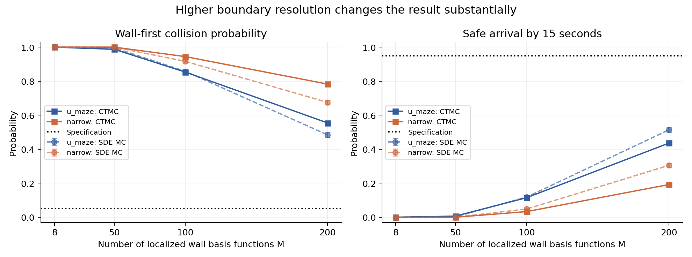
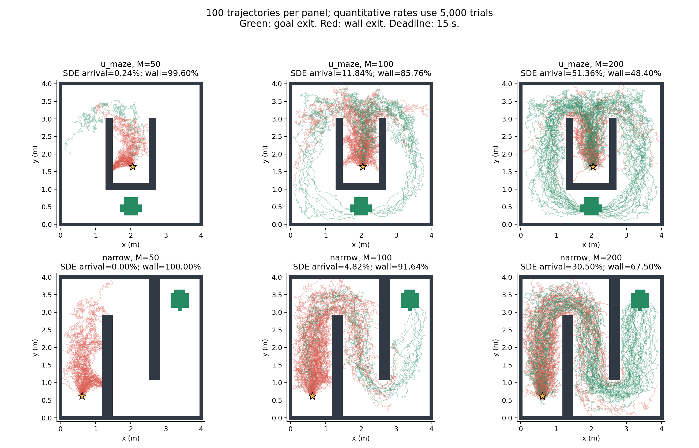
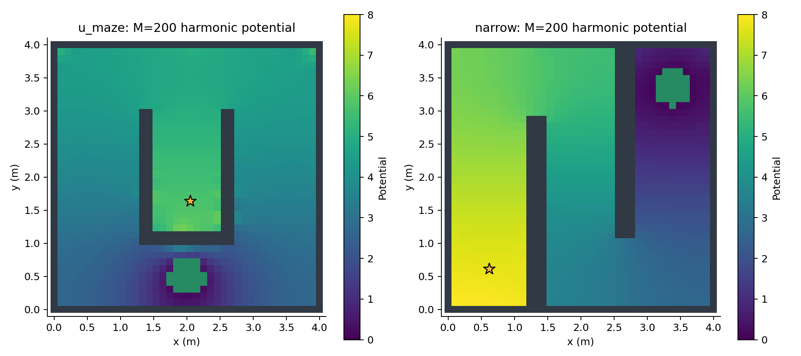

> Wall-safety correction: these earlier candidates did not enforce repulsion at every wall face. See [wall audit and corrected experiment](../wall_safety/report.md).

# Higher-resolution boundary synthesis: corrected experimental assessment

**The original M=8 experiment was underparameterized for drawing conclusions about the method.** This follow-up increases the actual wall-boundary spatial resolution, checks boundary matrix rank, and uses adjoints with substantially larger optimization budgets.

A fair size comparison below uses the same localized construction and adjoint optimizer at M=8, 50, 100, 200. It is distinct from the earlier broad radial M=8 basis. Local centers lie on real wall nodes, and Gaussian bandwidth decreases with center spacing. All boundary matrices had full column rank.

S2: delta=0.05, epsilon=0.05, T=15 s. Fixed physical geometry, 40x40 grid, sigma=0.2, gain=1, boundary coefficients in [0,8]. Each controller has 5,000 SDE trials and 5,000 exact CTMC jump trials.

| Maze | M | p CTMC | Collision SDE | q CTMC | Arrival SDE | Boundary rank |
|---|---:|---:|---:|---:|---:|---:|
| narrow | 8 | 1.000000 | 1.000000 | 0.000000 | 0.000000 | 8 |
| narrow | 50 | 0.999912 | 1.000000 | 0.000005 | 0.000000 | 50 |
| narrow | 100 | 0.944272 | 0.916400 | 0.032960 | 0.048200 | 100 |
| narrow | 200 | 0.782617 | 0.675000 | 0.191949 | 0.305000 | 200 |
| u_maze | 8 | 0.999790 | 1.000000 | 0.000010 | 0.000000 | 8 |
| u_maze | 50 | 0.987319 | 0.996000 | 0.006398 | 0.002400 | 50 |
| u_maze | 100 | 0.853212 | 0.857600 | 0.114764 | 0.118400 | 100 |
| u_maze | 200 | 0.554126 | 0.484000 | 0.435622 | 0.513600 | 200 |

## What changed in the conclusion

- Higher M produces large improvements in both mazes. M=8 was insufficient evidence for a negative assessment of the method.
- At M=200, U-maze SDE deadline success reaches 51.36%; narrow-maze success reaches 30.50%. All tested S2 controllers still miss the requested 95% success and 5% collision thresholds.
- This is evidence of representation sensitivity and partial navigation success, not global infeasibility. M=50 is not a universal sufficiency threshold. Resolution of each wall face, conditioning, coefficient range, noise, and optimization also matter. These changing bases are not mathematically nested, so monotone improvement is an observed trend, not a guarantee.
- M=200 controls 200 of 250 U-maze or 260 narrow-maze wall boundary nodes on this grid. A substantially larger M should be paired with a finer maze grid rather than redundant columns.
- Main CLI defaults now use M=8 for open space and M=200 localized bases plus adjoint search for complex mazes.

## Optimization and numerical checks

Each evaluation differentiates the exact discrete backward-Euler recurrences via an adjoint, so gradient cost does not require M separate PDE evaluations. Three initializations use negative-log-arrival search to leave the flat near-zero-arrival region, followed by the requested joint maximum-violation objective. M=50/100 use 180 warm-up iterations per seed; M=200 uses 240. Final candidates are compared using matrix-exponential CTMC probabilities.

Four numerical tests passed, including Appendix B reproduction, independent CTMC jump simulation, and adjoint gradients checked against independent finite differences. CTMC and SDE results differ because of spatial upwinding, cell-face absorption and SDE stepping; no continuum certification is claimed. No u_max constraint is imposed; actual maximum sampled commands are recorded.

## Data and reproduction

- All coefficients, Wilson intervals, speed maxima, optimization histories and independent CTMC MC: `data/comparison.json` and `data/comparison.csv`.
- Each S2-synthesized controller is also evaluated under all five original specifications in `fixed_controller_spec_evaluation`. Those extra rows reuse the controller; they are not separate reoptimizations.
- The initial three-maze/five-spec separately optimized suite remains in `../data/summary.json`.

```powershell
python high_basis.py --basis 50 100 8 --maxiter 180 --mc 5000 --wall-safety free
python high_basis.py --basis 200 --maxiter 240 --mc 5000 --wall-safety free --output outputs/high_basis_200
python summarize_high_basis.py
python -m unittest -v test_numerics
```






