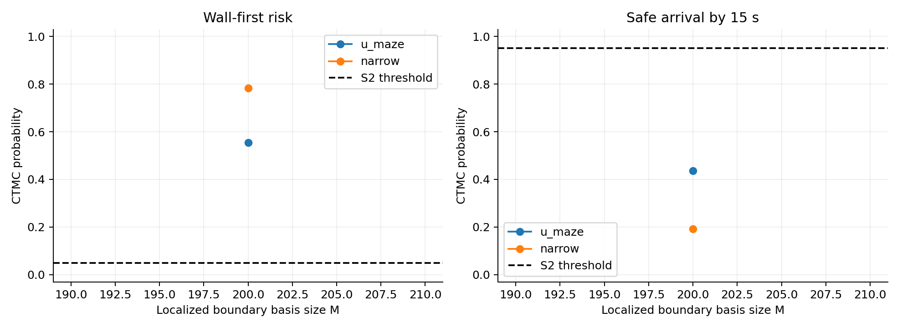

# Higher-dimensional harmonic boundary experiment

This supersedes conclusions drawn only from the initial M=8 broad boundary basis. Localized wall functions are placed by farthest-point sampling on actual wall boundary nodes. Their bandwidth decreases with center spacing. All cases use exact discrete adjoints, negative-log-arrival initialization followed by direct maximum specification violation. Final probabilities use the matrix exponential; SDE and exact CTMC Monte Carlo use 5,000 trials each.

Total higher-basis suite runtime: 1.46 minutes.

| Maze | M | Boundary rank | p CTMC | Wall SDE | q CTMC | Arrival SDE | rho | CTMC pass |
|---|---:|---:|---:|---:|---:|---:|---:|---|
| narrow | 200 | 200 | 0.78262 | 0.67500 | 0.19195 | 0.30500 | 0.75805 | False |
| u_maze | 200 | 200 | 0.55413 | 0.48400 | 0.43562 | 0.51360 | 0.51438 | False |

These tests keep sigma=0.2, coefficient bounds [0,8], the same geometry and T=15. M changes representation; the local optimizer is still not a global feasibility test. Grid probabilities and SDE empirical frequencies remain distinct models. No command-speed limit is imposed. Coefficients, actual grid maximum commands, confidence intervals and all five specification evaluations are saved in data/summary.json.

