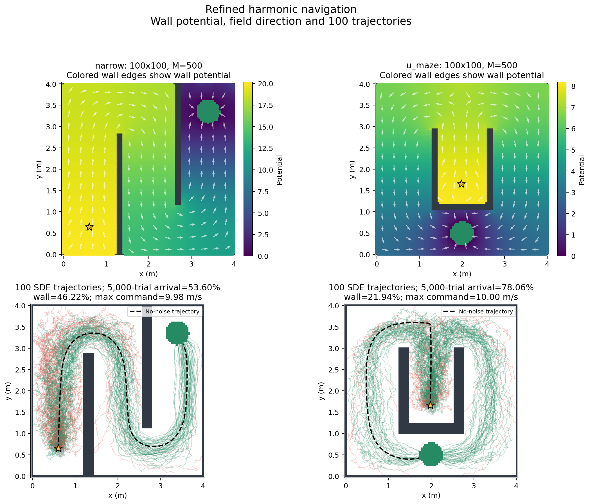
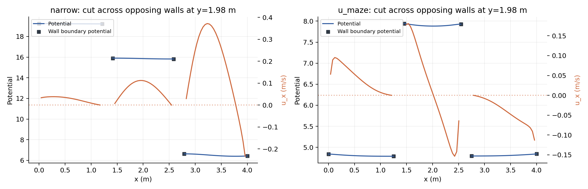

# U maze / Narrow: final M=500 dense-grid validation

Only the two requested mazes were rerun. Grid=100x100, h=0.040404 m, M=500, sigma=0.2, k=1. The first prototype used 40x40 and M=8; these final results also correct the interpolation and boundary representation.

## Concrete corrections after rereading the draft

- Sections 3 and 4.1: periodic continuous piecewise-linear wall boundary functions, separate along each contour, zero goal potential, sparse harmonic extensions. Both boundary matrices have rank 500. Opposite sides of a wall are not mixed by a Euclidean radial kernel.
- The SDE formerly interpolated fictitious gradients inside solid cells. Now it uses only free-space gradients, with normalized nonnegative interpolation weights. No inverse-distance/nonharmonic barrier was added.
- Hard wall constraints enforce wall >= adjacent free potential and non-outward actual interpolated commands. Final projection includes exact face endpoints/corners. Each final field is independently sampled at 11 points on every wall face, including endpoints. The earlier near-endpoint constraints left tiny corner leaks; those have been removed before the final Monte Carlo.
- Final coefficients lie in [1,80], so the continuous hat-function wall trace is >=1, not merely sampled wall nodes. This coefficient range is a modeling choice, not a number specified by the paper.
- Section 3 command bound: ||u||<=10 m/s at every interior node. Convex free-only interpolation preserves this bound. The 10 m/s value is an explicit experimental choice. The deployed command is not clipped.
- Sections 4.4 and 4.5: killed upwind CTMC, separate eventual-wall and finite-deadline backward equations, discrete adjoints and direct rho minimization after log-arrival initialization. Final probabilities are recomputed with the matrix exponential.
- The wall-start potential margin in Eq. (5.2) is a separate sufficient certificate. Its pass flag is reported honestly; local repulsion does not imply this certificate or the stochastic specifications.

## Final quantitative results

| Maze | p CTMC | Wall SDE | q(15) CTMC | Arrival SDE | Half-step arrival | No-noise goal by 15s | Max command | Actual outward wall samples |
|---|---:|---:|---:|---:|---:|---:|---:|---:|
| narrow | 0.528654 | 0.462200 | 0.468431 | 0.536000 | 0.517500 | 1 | 9.97901 | 0 |
| u_maze | 0.259183 | 0.219400 | 0.740147 | 0.780600 | 0.786000 | 1 | 10.00000 | 0 |

SDE main sample: 5,000 per maze. Half-step sensitivity: 2,000 per maze. Independent exact CTMC jump simulation: 5,000 per maze. All Wilson intervals, theta, timeouts, exit times, audit extrema, optimizer messages and 7/10/15-second evaluations are in `data/summary.json`.

## Interpretation of opposite-wall collisions

The old interpolation defect could create wall-directed commands even when node-only tests passed. That was an implementation error. Final drift audits include actual physical pixel-face corners, and deterministic trajectories test the noise-free field. SDE step-size comparisons test numerical overshoot. A collision despite a non-outward boundary command is possible with Brownian disturbance and a finite barrier. A last-step directional diagnostic alone is not a complete attribution of a trajectory to an opposing wall.

## Limits and conclusion

The requested S2 target remains wall risk <=5% and arrival by 15s >=95%. A failed candidate is UNDETERMINED, not a global impossibility result. Upwind CTMC artificial diffusion and node-vs-cell-face absorption still create spatial model error. Finite-step SDE and Monte Carlo intervals are not continuum certificates. M, grid, boundary basis, interpolation, wall constraints, coefficient range and speed bound all changed; these results must not be presented as an isolated M-only ablation.

## Reproduction

```powershell
python refined_M500.py
python finalize_refined.py
python polish_U_M500.py
python finalize_refined.py --mazes u_maze
python -m unittest -v test_numerics
```

The saved final theta/fields reproduce evaluation directly; reoptimization can choose another local candidate. Source hashes for final validation are in `logs/source_hashes.json`.





## Deterministic exit details

- narrow: wall fraction=0; eventual goal fraction within audit horizon=1; exit time=8.698559566629395; deadline arrival=1.
- u_maze: wall fraction=0; eventual goal fraction within audit horizon=1; exit time=11.831565656565497; deadline arrival=1.