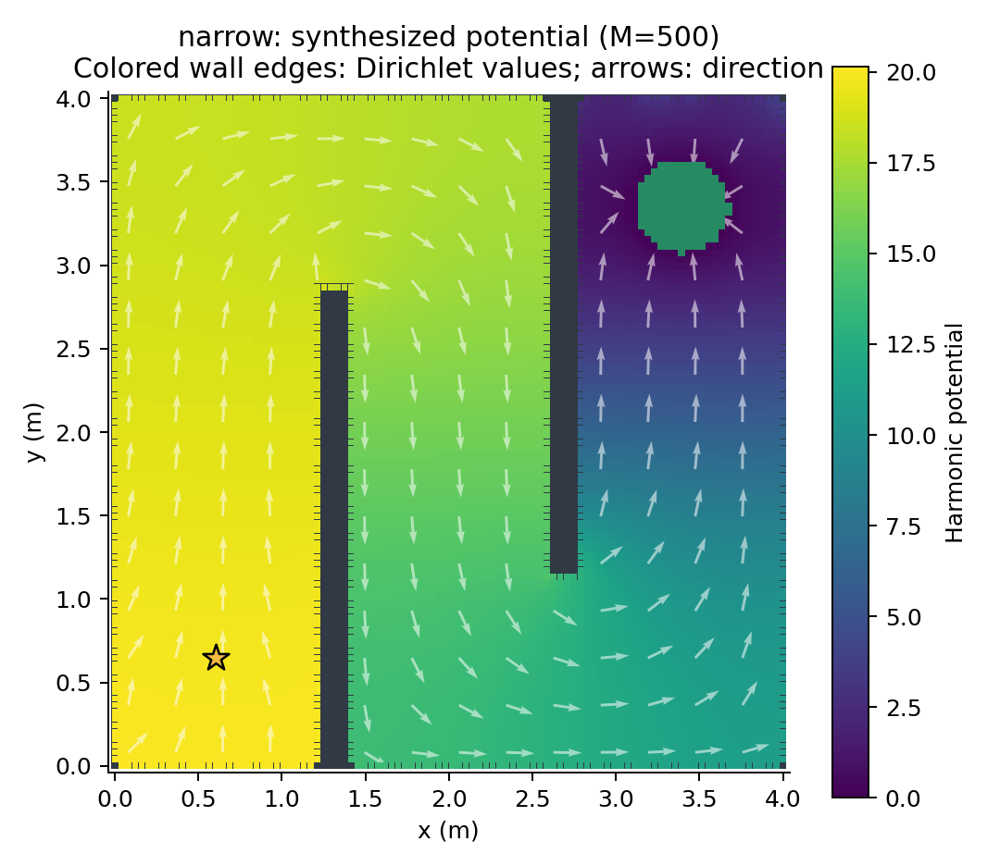
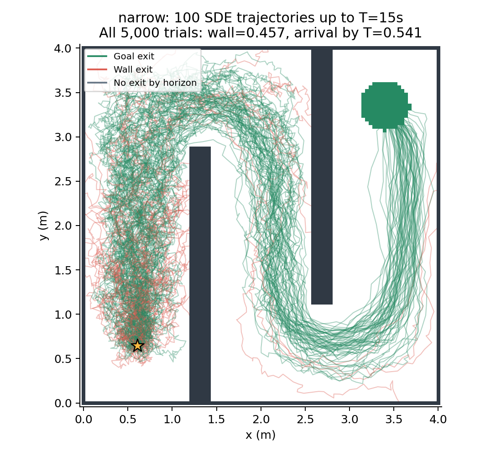

# U / Narrow: refined M=500 rerun

Grid: 100x100; M=500; sigma=.2; k=1; coefficient bounds [0,80.0]; sampled command bound 10.0 m/s. Runtime: 10.00 min. Both mazes only.

## Paper alignment and implementation correction

- Rechecked Sections 3, 4 and 5 plus numerical-verification appendix of `../../../output/pdf/main.pdf`.
- Continuous periodic piecewise-linear functions along each actual wall contour, as allowed in Section 4.1. The two sides of an obstacle are not coupled solely by Euclidean proximity. Zero goal Dirichlet data; sparse Laplace harmonic extension; u=-k grad V; no inverse-distance/nonharmonic term.
- Fixed a real interpolation defect: earlier SDE evaluation mixed gradients inside solid obstacles into free-space commands. Now only free-node gradients enter a normalized convex interpolation. This change is linear in theta.
- Wall potential floor, uphill wall edge, and non-outward commands at endpoints and midpoints of every pixel wall face are hard linear constraints. The actual simulation interpolator is rechecked after optimization.
- The paper command bound is now explicit and checked at all interior nodes. Convex free-only interpolation cannot exceed the maximum grid-node norm. Command clipping is not used.
- Independent adjoints of the time-stepping equations guide optimization; final CTMC probabilities are recomputed using a matrix exponential. Exact CTMC jump MC, SDE half-step checks and deterministic trajectories separate model, stepping and field-direction effects.
- Compared with previous runs, M, grid, boundary basis, interpolation, coefficient range and speed constraints changed. The performance change cannot be attributed to M alone.

| Maze | p CTMC | Wall SDE | q(15) CTMC | Arrival SDE | Half-step arrival | Deterministic arrival | Actual outward wall commands |
|---|---:|---:|---:|---:|---:|---:|---:|
| narrow | 0.528651 | 0.457200 | 0.468434 | 0.540600 | 0.514500 | 1 | 0 |

S2 target: collision <=.05 and safe arrival by 15s >=.95. A failed local solve is UNDETERMINED, not infeasibility. Local repulsion is separate from the sufficient global wall-start potential margin in draft Eq. (5.2); its pass flag is in each wall audit. These are numerical discrete-model and empirical results, not verified continuum guarantees.

## Collision interpretation

The deterministic trial tests whether the field itself reaches a wall or the goal. The stochastic collision diagnostic records the last precontact command component toward the hit cell; it is an instantaneous diagnostic, not proof of a complete opposite-wall causal mechanism. Half-step trials test sensitivity to numerical crossing/overshoot. See all values and intervals in `data/summary.json`.

```powershell
python refined_M500.py
python -m unittest -v test_numerics
```




