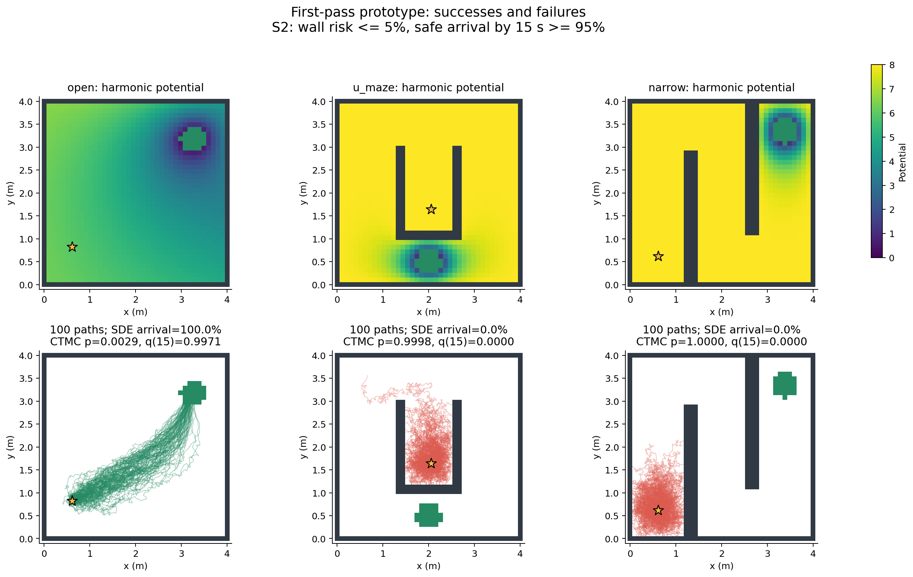

> Wall-safety correction: see [actual wall potentials and corrected wall-repulsive experiments](wall_safety/report.md).

> Updated assessment: the M=8 pilot does not establish a limitation of the method. See the [M=50/100/200 follow-up](high_basis/report.md), which shows substantial improvement with higher boundary resolution.

# Harmonic navigation: first experimental prototype

Completed 15 maze/spec pairs in 7.36 minutes. CTMC specification pass: 5/15; SDE empirical pass using marginal 95% Wilson intervals: 5/15.

## Implementation

- Python/NumPy/SciPy/matplotlib, CPU only; grid=40x40, M=8, sigma=0.2 m/sqrt(s), gain=1.0 m^2/s, seed=20261101.
- A 4 m square workspace, 0.28 m goal radius, a point robot, and three fixed occupancy geometries.
- Smooth Gaussian wall partition of unity, zero goal potential, sparse five-point Laplace solves; coefficients restricted to [0, 8.0]. This is a chosen subfamily of the draft.
- Drift uses centered grid gradients. CTMC uses diffusion plus nonnegative upwind drift rates (draft Eq. 4.10).
- Optimization minimizes max(0, p-delta, 1-epsilon-q) with a tiny probability tie-breaker, random initial candidates and bounded L-BFGS-B. Search uses 72-step backward Euler; three final candidates are ranked by matrix-exponential probabilities.
- Final p is a sparse linear solve; final q is g-exp(TQ)g. These are numerical evaluations of the finite CTMC, not continuum certificates.
- Euler-Maruyama uses bilinear drift interpolation and occupancy-cell absorption; risk trials continue to max(3T,45s). Unabsorbed trials yield [wall fraction, wall fraction + timeout fraction] bounds on eventual risk. Mean exit among observed exits is conditional; the restricted mean includes censoring.
- No speed saturation or prescribed u_max constraint was imposed. Actual grid-node maximum commands are reported. No global infeasibility, continuum certification, or HJB proof is claimed.

## Main numerical results

| Maze | Spec (delta,epsilon,T) | p CTMC | Wall SDE | q CTMC | Arrival SDE | rho | CTMC / SDE CI pass |
|---|---|---:|---:|---:|---:|---:|---|
| open | S1 (0.1,0.1,15) | 0.00771 | 0.00080 | 0.99227 | 0.99920 | 0.00000 | True / True |
| open | S2 (0.05,0.05,15) | 0.00287 | 0.00000 | 0.99713 | 1.00000 | 0.00000 | True / True |
| open | S3 (0.01,0.05,15) | 0.00287 | 0.00000 | 0.99713 | 1.00000 | 0.00000 | True / True |
| open | S4 (0.05,0.05,10) | 0.00287 | 0.00000 | 0.99712 | 1.00000 | 0.00000 | True / True |
| open | S5 (0.05,0.05,7) | 0.00287 | 0.00000 | 0.99571 | 1.00000 | 0.00000 | True / True |
| u_maze | S1 (0.1,0.1,15) | 0.99982 | 1.00000 | 0.00000 | 0.00000 | 0.90000 | False / False |
| u_maze | S2 (0.05,0.05,15) | 0.99982 | 0.99940 | 0.00000 | 0.00000 | 0.95000 | False / False |
| u_maze | S3 (0.01,0.05,15) | 0.99949 | 0.99980 | 0.00000 | 0.00000 | 0.98949 | False / False |
| u_maze | S4 (0.05,0.05,10) | 0.99949 | 0.99980 | 0.00000 | 0.00000 | 0.95000 | False / False |
| u_maze | S5 (0.05,0.05,7) | 0.99949 | 0.99980 | 0.00000 | 0.00000 | 0.95000 | False / False |
| narrow | S1 (0.1,0.1,15) | 1.00000 | 0.99960 | 0.00000 | 0.00000 | 0.90000 | False / False |
| narrow | S2 (0.05,0.05,15) | 1.00000 | 0.99920 | 0.00000 | 0.00000 | 0.95000 | False / False |
| narrow | S3 (0.01,0.05,15) | 1.00000 | 0.99940 | 0.00000 | 0.00000 | 0.99000 | False / False |
| narrow | S4 (0.05,0.05,10) | 1.00000 | 0.99940 | 0.00000 | 0.00000 | 0.95000 | False / False |
| narrow | S5 (0.05,0.05,7) | 1.00000 | 0.99940 | 0.00000 | 0.00000 | 0.95000 | False / False |

All coefficients, confidence intervals, horizons, timeout rates, speeds, and optimizer messages are in `data/summary.json` and `data/summary.csv`.

## Synthesized coefficients

- open/S1: theta=[8.0, 8.0, 8.0, 8.0, 8.0, 8.0, 8.0, 8.0]; max grid command=20.834 m/s; timeout=0.0000.
- open/S2: theta=[0.88864, 4.35801, 6.66686, 7.09296, 5.39547, 7.13613, 4.84941, 6.31682]; max grid command=10.936 m/s; timeout=0.0000.
- open/S3: theta=[0.88864, 4.35801, 6.66686, 7.09296, 5.39547, 7.13613, 4.84941, 6.31682]; max grid command=10.936 m/s; timeout=0.0000.
- open/S4: theta=[0.88864, 4.35801, 6.66686, 7.09296, 5.39547, 7.13613, 4.84941, 6.31682]; max grid command=10.936 m/s; timeout=0.0000.
- open/S5: theta=[0.88864, 4.35801, 6.66686, 7.09296, 5.39547, 7.13613, 4.84941, 6.31682]; max grid command=10.936 m/s; timeout=0.0000.
- u_maze/S1: theta=[8.0, 7.9998, 8.0, 8.0, 8.0, 8.0, 8.0, 8.0]; max grid command=28.467 m/s; timeout=0.0000.
- u_maze/S2: theta=[8.0, 7.9998, 8.0, 8.0, 7.9998, 8.0, 8.0, 8.0]; max grid command=28.467 m/s; timeout=0.0004.
- u_maze/S3: theta=[5.06377, 8.0, 6.29156, 6.95633, 7.03837, 5.58725, 8.0, 8.0]; max grid command=25.748 m/s; timeout=0.0002.
- u_maze/S4: theta=[5.06397, 8.0, 6.29156, 6.95633, 7.03837, 5.58725, 8.0, 8.0]; max grid command=25.748 m/s; timeout=0.0000.
- u_maze/S5: theta=[5.06417, 8.0, 6.29156, 6.95633, 7.03837, 5.58725, 8.0, 8.0]; max grid command=25.748 m/s; timeout=0.0000.
- narrow/S1: theta=[8.0, 8.0, 8.0, 8.0, 8.0, 8.0, 8.0, 7.9998]; max grid command=24.890 m/s; timeout=0.0004.
- narrow/S2: theta=[7.9998, 8.0, 8.0, 8.0, 8.0, 8.0, 8.0, 7.9998]; max grid command=24.890 m/s; timeout=0.0008.
- narrow/S3: theta=[7.9998, 7.9998, 8.0, 8.0, 8.0, 8.0, 8.0, 7.9998]; max grid command=24.890 m/s; timeout=0.0006.
- narrow/S4: theta=[7.9998, 7.9998, 8.0, 8.0, 8.0, 8.0, 8.0, 7.9998]; max grid command=24.890 m/s; timeout=0.0006.
- narrow/S5: theta=[7.9998, 7.9998, 8.0, 8.0, 8.0, 8.0, 8.0, 7.9998]; max grid command=24.890 m/s; timeout=0.0006.

## Diagnosis and limits

- A nonzero local-search violation is **UNDETERMINED**, not evidence of mathematical infeasibility. Narrow passages, strong harmonic screening far from the goal, limited boundary basis, bounded coefficients, and finite search budget can each cause failure.
- Upwind CTMC adds drift-dependent artificial diffusion of order h. Its predicted risk can differ materially from SDE Monte Carlo even when the linear-system residual is tiny. Occupancy-cell face absorption vs absorbing grid nodes is another spatial error.
- Euler-Maruyama and line-segment contact checks can miss between-step Brownian crossings; Monte Carlo intervals quantify sampling error only. Grid/time-step audits are saved separately.
- In S1, S2, S4, and S5, delta=epsilon. Since q(T)<=1-p, satisfying the deadline condition already implies the risk condition. Only S3 imposes a strictly tighter separate risk budget. Consequently these specifications alone provide limited evidence that a joint objective outperforms time-only synthesis.
- The optimizer may stop just inside a constraint. Such a CTMC pass can fail an empirical confidence-interval test; a deployment-oriented implementation should synthesize a margin.

## Ablations

| Maze | Controller | p CTMC | q CTMC | rho | Wall SDE | Arrival SDE |
|---|---|---:|---:|---:|---:|---:|
| open | joint | 0.00287 | 0.99713 | 0.00000 | 0.00000 | 1.00000 |
| open | fixed | 0.21033 | 0.44919 | 0.50081 | 0.18680 | 0.46560 |
| open | risk_only | 0.00006 | 0.99994 | 0.00000 | 0.00000 | 1.00000 |
| open | time_only | 0.00006 | 0.99994 | 0.00000 | 0.00000 | 1.00000 |
| u_maze | joint | 0.99982 | 0.00000 | 0.95000 | 0.99940 | 0.00000 |
| u_maze | fixed | 0.99996 | 0.00000 | 0.95000 | 0.99980 | 0.00000 |
| u_maze | risk_only | 0.99964 | 0.00000 | 0.95000 | 0.99980 | 0.00000 |
| u_maze | time_only | 0.99982 | 0.00000 | 0.95000 | 1.00000 | 0.00000 |
| open | fixed_8 | 0.00771 | 0.99227 | 0.00000 | 0.00080 | 0.99920 |

## Numerical audits

| Maze | Exact p | CTMC MC wall | Exact q | CTMC MC arrival | BE-72 q | Half-step SDE arrival |
|---|---:|---:|---:|---:|---:|---:|
| open | 0.002874 | 0.002400 | 0.997126 | 0.997600 | 0.997126 | 1.000000 |
| u_maze | 0.999821 | 0.999400 | 0.000000 | 0.000000 | 0.000001 | 0.000000 |
| narrow | 1.000000 | 1.000000 | 0.000000 | 0.000000 | 0.000000 | 0.000000 |

Full confidence intervals and time-step audits are in `data/audits.json`. Three independent numerical tests reproduce Appendix B, check exact jump Monte Carlo, and verify harmonic/time-monotonicity invariants (`python -m unittest -v test_numerics`).

## Files and reproduction

- Figures: `figures/*_potential.png`, `*_trajectories.png`, `specification_satisfaction.png`, `specification_sweep.png`, `ablations.png`, `runtime_scalability.png`.
- Detailed results: `data/summary.csv`, `summary.json`, `ablations.json`, `runtime.json`, `audits.json`.
- Reproduce this run: `python main.py --suite full --grid 40 --basis 8 --mc 5000 --budget 160 --seed 20261101` from `experiment/`.
- Default pilot: `python main.py --suite pilot` (one maze, 1,000 SDE trials).

## Additional failure diagnosis

Uniform wall potential 8 produces the following start speeds:

| Maze | Wall potential minus start potential | Start speed (m/s) |
|---|---:|---:|
| open | 0.1462 | 0.2984 |
| u_maze | 4.06e-06 | 1.289e-05 |
| narrow | 4.233e-10 | 1.187e-09 |

The goal influence is strongly screened in the U and narrow geometries. This is a controller-family/search difficulty, not a failed sparse solve. A geodesic-distance boundary hat basis at M=8 and M=16 also failed S2 in four 5,000-trial runs. A separate negative-log-arrival search escaped part of the flat objective region, but did not satisfy S2:

| Maze | Diagnostic search | CTMC p | CTMC q |
|---|---|---:|---:|
| u_maze | Geodesic M=16, -log q | 0.984604 | 0.009830 |
| narrow | Geodesic M=16, -log q | 0.998240 | 0.001064 |

The log-search controllers above were evaluated by CTMC only; no SDE validation is claimed for them. Diagnostics are reproducible with `python diagnostics.py`; the exploratory log-search coefficients and exact predictions are stored in `diagnostics/data/log_search.json`.

## Mesh refinement

| Maze | Grid | p CTMC | q CTMC |
|---|---:|---:|---:|
| open | 40 | 0.002874 | 0.997126 |
| open | 60 | 0.000413 | 0.999587 |
| open | 80 | 0.000167 | 0.999833 |
| u_maze | 40 | 0.999821 | 0.000000 |
| u_maze | 60 | 0.999882 | 0.000000 |
| u_maze | 80 | 0.999925 | 0.000000 |
| narrow | 40 | 1.000000 | 0.000000 |
| narrow | 60 | 1.000000 | 0.000000 |
| narrow | 80 | 1.000000 | 0.000000 |

These use the same boundary coefficients and do not reoptimize on each mesh. Rasterized walls/goals and the nearest-node start vary slightly with resolution. Refinement is a diagnostic, not a rigorous error bound.

## Practical conclusion

The amplitude-matched fixed wall potential 8 also satisfies every tested open-maze specification. The weak fixed=2 baseline fails, so improvement over that baseline alone cannot establish the benefit of adaptive boundary shaping. `fixed_8` reuses the identical already simulated S1 controller and deadline while applying S2 thresholds.

The end-to-end pipeline works and the simple maze is successful. The current harmonic boundary family and local synthesis are inadequate for both demanding mazes at the tested noise and coefficient range. This experiment does not support a broad claim of maze navigation success. Improving boundary control on individual wall faces, search conditioning, and long-corridor signal strength should precede theorem-level certification or larger benchmarks.

