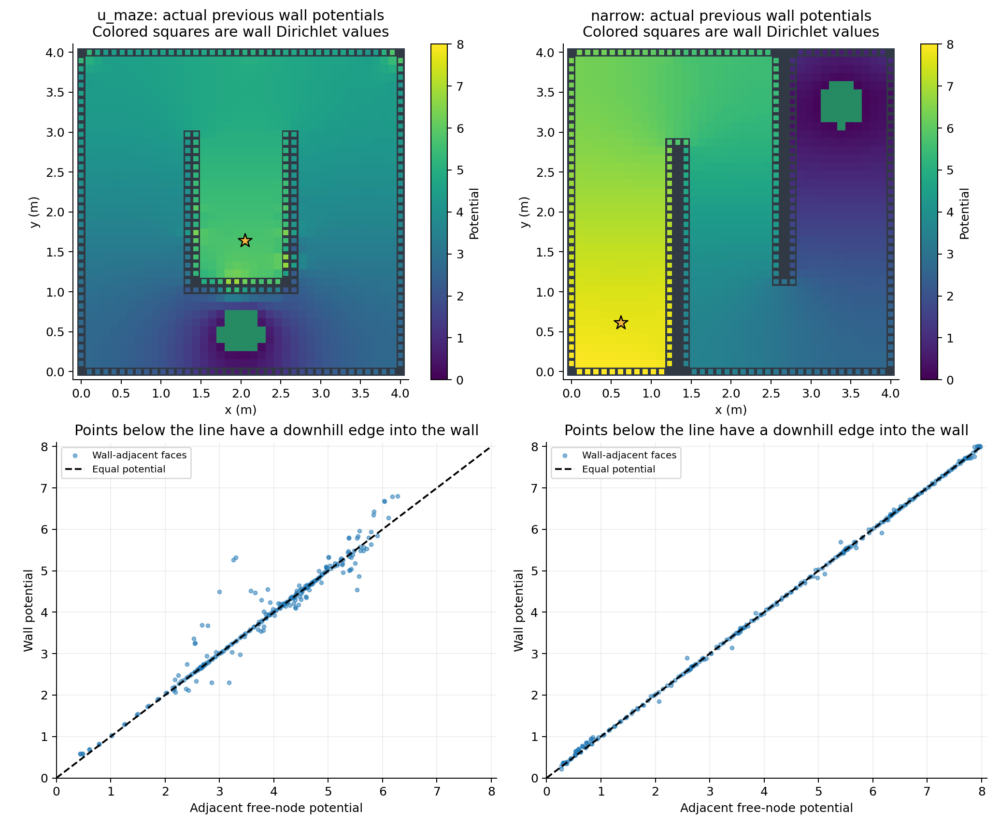

# 벽 전위 및 반발 조건 재점검

벽 전위를 빠뜨린 구현은 아니었습니다. 기존 구현은 벽 Dirichlet 값
`V_wall = C theta`, 목표 전위 0을 주고 자유공간에서 Laplace 방정식을 풉니다.
그러나 벽 계수를 자유롭게 최적화하면서 모든 벽이 인접 자유공간보다 높고
실제 명령이 벽에서 멀어져야 한다는 조건은 강제하지 않았습니다.
기존 그림은 벽을 회색으로 덮어 실제 벽 전위를 보여주지 않았습니다.

이 점은 사용자가 원한 항상 반발하는 벽 조건과 달랐습니다. 앞선 도착률은
벽 반발을 강제하지 않은 후보들의 비교 결과로 해석해야 합니다.

## M=200 기존 결과의 실제 벽 전위

| 미로 | 벽 전위 범위 | 시작점 전위 | 벽이 인접 자유공간보다 낮은 면 | 명령이 벽을 향하는 면 |
|---|---:|---:|---:|---:|
| U | 0.575–6.798 | 5.720 | 29.30% | 24.22% |
| Narrow | 0.220–8.000 | 7.721 | 31.06% | 24.24% |

벽이 목표 전위 0보다 높다는 조건만으로는 반발을 보장하지 않습니다.
제어는 절대값이 아니라 `-k grad V`로 결정되므로, 벽이 주변 자유공간보다
낮으면 벽으로 향하는 흐름이 생길 수 있습니다.



## 논문과의 정확한 관계

참조는 `../../../output/pdf/main.pdf`입니다.
논문 4.1절은 벽 경계 계수를 자유롭게 두는 조화 기저를 정의합니다.
4.5절의 직접 확률 최적화와 5절의 충분조건에 의한 위험 인증은 별개입니다.
기존 실험은 직접 확률 최적화였으며, 정리 4의 식 (5.1)–(5.2)를 강제하지 않았습니다.

그 위험 인증 조건은 **모든 벽**에 대해

`V(w) - V(x0) >= sigma^2/(2k) log(1/delta)`

입니다. sigma=0.2, k=1, delta=0.05일 때 필요한 전위 차이는 약 **0.059915**입니다.
기존 두 M=200 후보는 이 조건을 통과하지 못합니다.
계수 범위 [0,8]에서 이 최소 벽-시작점 차이를 최대화한 이산 LP도
U에서는 약 4.06e-6, Narrow에서는 수치 허용오차 수준인 약 1e-9까지만 얻었습니다.
이는 이 범위에서 해당 **충분조건**을 만족시키기 어렵다는 진단이며,
확률 사양 자체가 불가능하다는 증명이 아닙니다. LP 수치는 검증된 구간 산술 인증이 아닙니다.

또한 벽을 모두 8로 고정해도 U 시작점은 약 7.99999594, Narrow 시작점은
약 7.99999999958로 올라갑니다. 따라서 벽의 절대 전위가 크다고 해서
주변과의 전위 차이 또는 반발력이 충분한 것은 아닙니다.

## 실제 수정 사항

`src/wall_safety.py`에 벽 전위와 실제 제어 방향을 명시적으로 검사하는 함수를 추가했습니다.
`main.py`와 `high_basis.py`의 기본값은 이제 `--wall-safety repulsive`입니다.

각 벽 인접 격자 면에서 다음 선형 조건을 강제합니다.

1. 벽 전위가 지정한 하한 이상: 기본 `--wall-floor 1`.
2. 벽 전위가 인접 자유 노드 전위 이상.
3. 실제 명령의 벽 바깥 방향 성분이 0 이하.

`--minimum-inward-speed`로 양의 최소 반발 속도를 요구할 수 있습니다.
기본값 0은 벽을 향하는 명령을 금지하는 조건이며, 강한 반발력이나 확률 안전 인증은 아닙니다.
최종 후보는 원래 물리 단위의 조건으로 재검사하고, 위반하면 받아들이지 않습니다.
이 조건들은 사용자가 요청한 벽 반발을 명시화한 추가 제약이며, 논문 식 (5.2)와 동일한 조건은 아닙니다.
식 (5.2)의 전위 차이 통과 여부는 별도로 기록합니다.

조화성을 유지하기 위해 `1/d` 등의 비조화 반발 항을 몰래 더하지 않았습니다.

## 반발 제약을 적용한 M=200 재실험

같은 격자, sigma, 계수 상한 8에서 두 초기값과 SLSQP/수반 기울기를 사용했습니다.
각 후보를 SDE 5,000회로 확인했습니다.

| 미로 | 벽을 향하는 명령 | p CTMC | 충돌 SDE | q(15) CTMC | 15초 도착 SDE |
|---|---:|---:|---:|---:|---:|
| U | 0% | 0.93805 | 0.93520 | 0.02157 | 0.01920 |
| Narrow | 0% | 0.95148 | 0.95460 | 0.00172 | 0.00040 |

두 후보 모두 국소 반발 검사에는 통과하지만, 위험·시간 사양에는 실패했습니다.
일부 벽에서 최솟값이 수치 오차 범위의 0에 가까워 반발이 약할 수 있습니다.
따라서 이는 충분히 강한 안전 장벽을 얻었다는 성공 결과가 아닙니다.
단순한 반발 방향 제약과 충분한 반발 강도, 논문의 확률 인증은 분리해서 봐야 합니다.
이 실패 역시 제한된 범위의 국소 최적화 결과이며 방법 전체의 불가능 판정이 아닙니다.

전체 계수와 벽 감사 수치는 `data/audit.json`, `data/repulsive_results.json`에 있습니다.

```powershell
python check_wall_potential.py
python main.py --suite full --wall-safety repulsive
python high_basis.py --basis 200 --wall-safety repulsive
python -m unittest -v test_numerics
```

수치 테스트 5개를 통과했습니다. 추가 테스트는 벽 전위 차이와 실제 명령의
법선 성분이 제약 행렬 계산과 일치하는지 확인합니다.
